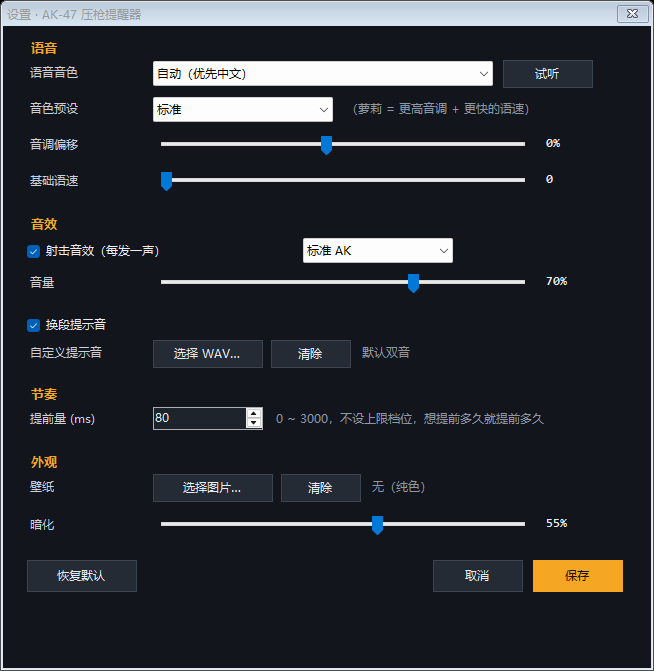

# AK-47 Spray Coach (CS2)

[](../../releases)
[](LICENSE)
[](#)

[中文](README.md) | **English**

A 47 KB Windows tray-free utility that walks you through the **CS2 AK-47 spray pattern** in real time: hold the left mouse button and it cues — by voice and a big arrow — **which way to drag your mouse**, one round every 0.1 s (600 RPM). Release to stop. Each hold speeds up the voice a notch.


## Download

Grab **`AK47SprayCoach.exe`** from [Releases](../../releases) and double-click it (the window title is in Chinese).

- Single executable, **no dependencies** (.NET Framework 4.x ships with Windows 10/11)
- No network access, no registry writes, no game memory reads, no input injection
- Always-on-top by default — put it on a second monitor

## The timings

AK-47: 600 RPM → **one round every 0.1 s**, full 30-round spray = **3.0 s**.

| Segment | Rounds | Time | Drag mouse | Strength |
|---|---|---|---|---|
| 1 | 1–4 | 0.00–0.40s | **↓ straight down** | strong |
| 2 | 5–8 | 0.40–0.80s | **↘ down-right** (slight) | weak |
| 3 | 9–14 | 0.80–1.40s | **↙ down-left** — the big one | strong |
| 4 | 15–19 | 1.40–1.90s | **↘ down-right** | medium |
| 5 | 20–24 | 1.90–2.40s | **↙ down-left** | medium |
| 6 | 25–30 | 2.40–3.00s | **↘ down-right** | medium |

Directions are always **where the mouse goes** (= opposite of where the pattern drifts). Mnemonic: `down → right-down → left-down → right-down → left-down → right-down`.

## Features

- **Hold LMB to start, release to stop** — global mouse listener, so it works while you're in-game (passive only, nothing injected)
- **Progressive voice speed**: +1 per completed spray (cap +6), toggleable
- **Custom gunshot SFX** (v1.2): every round plays a shot sound — the built-in synthesised AK report by default, or **any local wav/mp3 you pick**, with volume control and a preview button
- **Fully custom voice** (v1.2): the "loli/girl/robot" presets are gone — just drag pitch (-50%…+60%) and rate (0…6) yourself, or pick any SAPI voice installed on the system
- **Lead time 0–3000 ms** (v1.1), no fixed steps
- **Custom wallpaper** (v1.1): any png/jpg as the window background, cover-fit with adjustable dimming (0–92%)
- Custom WAV for the segment-change cue
- 30-round cue strip, 6-segment timeline, spray-pattern diagram, cheat-sheet table
- `F2` opens the settings window; everything is stored in `settings.ini` next to the exe
- Dual TTS engine: in-process SAPI, falling back to a hidden PowerShell voice helper



## Verify it yourself

```bat
AK47SprayCoach.exe --selftest self-test.txt     :: data + timeline consistency
AK47SprayCoach.exe --demo 1500 --diag demo.log  :: walks a real 1.5 s spray
AK47SprayCoach.exe --say 左下 --diag say.txt     :: TTS check
AK47SprayCoach.exe --shot ui.png --at 1.35       :: render the UI to PNG
AK47SprayCoach.exe --sounds sounds               :: dump the synthesised SFX
AK47SprayCoach.exe --shot-settings settings.png  :: render the settings dialog
```

## Build

No .NET SDK or Visual Studio needed — the Windows-bundled C# compiler is enough:

```powershell
.\build.ps1
```

CI compiles the exe on every push and uploads it as an artifact (see [.github/workflows/build.yml](.github/workflows/build.yml)).

## Disclaimer

Timing/rhythm trainer only. It does not read, inject into or modify the game. The pattern diagram is a schematic skeleton, not extracted game data. Not affiliated with Valve.

## License

[MIT](LICENSE)
