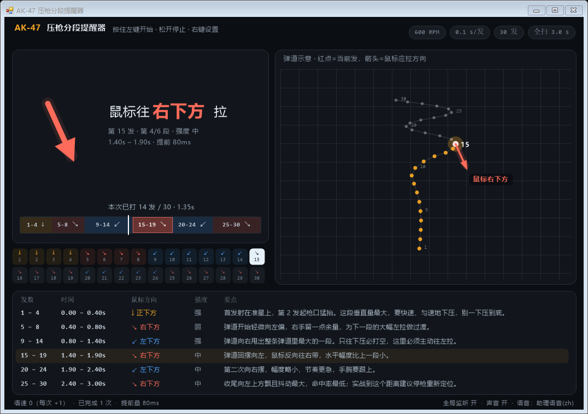

# AK-47 压枪分段提醒器 · Spray Coach

**中文** | [English](README.en.md)

> 一个 47 KB 的 Windows 小工具：按住鼠标左键就按真实的 **600 发/分** 射速逐发提示你「现在该往哪个方向拉枪」，松开即停，每按住一次语音语速 +1。



---

## 下载

到 [Releases](../../releases) 下载 `AK47压枪提醒器.exe`，双击运行。

- 单文件、**零依赖**：.NET Framework 4.x 是 Windows 10/11 自带的，不需要装运行库
- 不联网、不写注册表、不读游戏内存、不模拟输入
- 默认窗口置顶，适合放副屏

## 它解决什么问题

CS2 的 AK-47 前 30 发弹道是**固定**的，但大多数人的问题是「记不住第几发该往哪边拉」。这个工具把整条弹道切成 6 段，用**语音 + 音效 + 大箭头**按 0.1 秒一发的节奏告诉你下一步往哪拉：

| 段 | 发数 | 时间 | 鼠标方向 | 强度 | 要点 |
|---|---|---|---|---|---|
| 1 | 1–4 | 0.00–0.40s | **↓ 正下方** | 强 | 首发射在准星上，第 2 发起枪口猛抬，快速匀速下压 |
| 2 | 5–8 | 0.40–0.80s | **↘ 右下方** | 弱 | 弹道轻微左偏，右手留余量过渡 |
| 3 | 9–14 | 0.80–1.40s | **↙ 左下方** | 强 | 弹道向右甩出最大一段，只往下压必打空——最容易漏 |
| 4 | 15–19 | 1.40–1.90s | **↘ 右下方** | 中 | 弹道回摆向左，反向往右带 |
| 5 | 20–24 | 1.90–2.40s | **↙ 左下方** | 中 | 第二次右摆，幅度略小、节奏更急 |
| 6 | 25–30 | 2.40–3.00s | **↘ 右下方** | 中 | 收尾左飘 + 抖动最大，建议停枪重定位 |

方向统一换算成**鼠标该往哪拉**（= 弹道走向的反方向）。口诀：`下 → 右下(微) → 左下(大) → 右下 → 左下 → 右下`。

## 功能

- **按住左键 = 开始扫射，松开 = 停止**（全局鼠标监听，游戏里按住开火键窗口就跟着提示，不用切屏）
- **语速递进**：每完成一次（≥2 发）语音语速 +1，0 → 6 档，逼自己提前反应；可右键关闭或重置
- **提前量** 0 / 50 / 80 / 120 / 160 ms 可调（默认 80ms，补偿人 100~200ms 的反应延迟）
- 30 格逐发提示条 + 6 段时间轴（可点击跳转）+ 弹道示意图 + 分段速查表
- 备用操作：按住空格；`Esc` 停止；右键出设置；拖动标题栏移动窗口
- 语音**双引擎**：进程内 SAPI 不可用时，自动改用隐藏的 PowerShell 语音助手（无窗口），状态栏会显示当前引擎

## 自检（不用真人操作）

```bat
:: 数据/时间轴一致性：30 个弹道点、6 段连续、方向与弹道走向严格相反
AK47压枪提醒器.exe --selftest self-test.txt

:: 真跑一遍 1.5 秒扫射（计时 / 提示 / 语音全流程）
AK47压枪提醒器.exe --demo 1500 --diag demo.log

:: 语音自检
AK47压枪提醒器.exe --say 左下 --diag say.txt

:: 把界面渲染成 png
AK47压枪提醒器.exe --shot ui.png --at 1.35
```

`--demo 1500` 的实测输出：

```
midShot=16 midSeg=3 | lastShots=16 duration=1.51s segAtStop=3 rounds=1 speedLevel=1
| voice ready=True engine=ps banner=READY zh
```

## 自己编译

不需要 .NET SDK / Visual Studio，用 Windows 自带的 C# 编译器即可：

```powershell
.\build.ps1
```

脚本会编译 `src/Ak47SprayCoach.cs` → `AK47压枪提醒器.exe`，并自动跑一遍数据自检。
GitHub Actions 也会在每次 push 时自动编译并上传 exe（见 [.github/workflows/build.yml](.github/workflows/build.yml)）。

## 改数据

`src/Ak47SprayCoach.cs` 里 `Engine` 类就是全部数据：

```csharp
public const int RateHz = 10;        // 600 RPM = 10 发/秒（M4A4 也是 10，M4A1-S 约 9）
public const int N = 30;             // 弹匣容量
public static readonly double[][] Pattern = ...;   // 弹道骨架（只影响右侧示意图）
public static readonly Seg[] Segs = ...;           // 分段表 —— 提示的唯一依据
```

改完跑 `.\build.ps1`，自检会检查每段「鼠标方向」是否与「弹道实际走向」自洽，不自洽会报 ✗。

## 目录

```
AK47压枪提醒器.exe (release 提供)
build.ps1                    一键编译 + 自检
src/Ak47SprayCoach.cs        全部源码（C# 5 + WinForms 自绘，单文件约 1500 行）
app.ico                      图标
docs/preview.png             截图
web/index.html               旧版网页版（可在手机/平板打开当对照表）
```

## 说明与免责

- 射速参数与 AK-47 循环射速 600 RPM 一致（与 [OP.GG 喷弹图样](https://op.gg/cs2/spray-patterns/ak47) 标注的 10.0 发/秒一致）；分段方向综合社区共识整理。
- 右侧弹道图是**等比例示意的骨架**，用于理解形状与节奏；逐发方向以分段表为准。真实弹道固定（人人一致），像素级坐标属游戏内数据，未逐个提取。
- 本工具只做**节拍与方向提示**：不读取游戏内存、不注入进程、不模拟/拦截输入，全局鼠标监听仅旁听事件。请遵守游戏与平台的使用条款。
- 与 Valve / Counter-Strike 无任何关联。

## License

[MIT](LICENSE)
